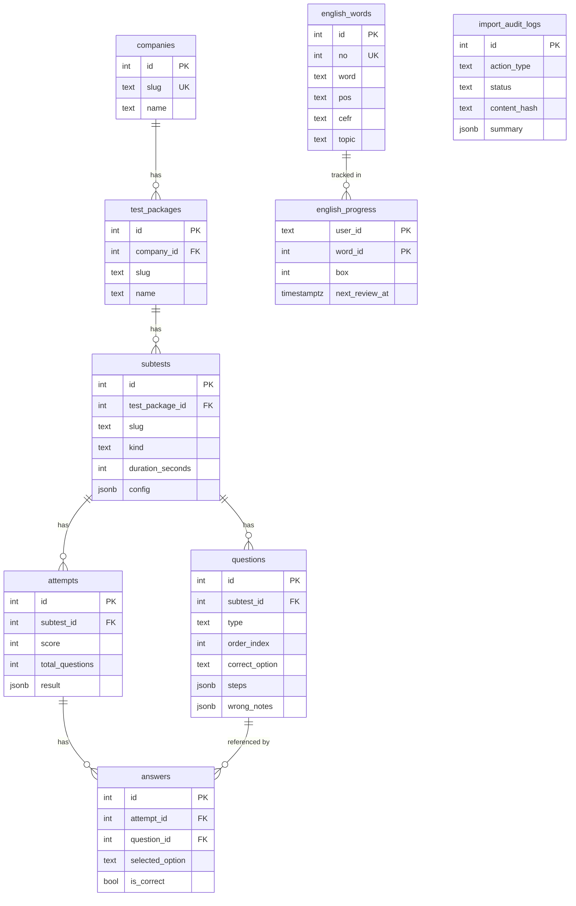

# PROJECT.md — Panduan Teknis & Arsitektur Sistem `e-assessment`

> Referensi menyeluruh tentang sistem **e-assessment** (Platform Latihan Psikotes & Materi Bahasa Inggris): arsitektur, struktur folder, batas modul, peta route, API, skema database, keamanan, pengujian, dan alur operasional.

---

## 1. Gambaran Umum Sistem

**e-assessment** adalah aplikasi web full-stack mandiri untuk:
1. **Simulasi Psikotes Seleksi Kerja/Magang** — mendukung berbagai penyelenggara (Astra, Paragon, dan dapat diperluas ke BUMN/CPNS lewat unggah JSON tanpa ubah kode), dengan 4 ragam subtes (`QUIZ`, `PERSONALITY`, `PAULI`, `DRAWING`), timer berbasis jam sistem, penilaian server-side, dan pembahasan langkah demi langkah.
2. **Materi Belajar Bahasa Inggris** — Kamus 1.000 Kata CEFR (`A1`–`C1`), mode Flashcard *spaced repetition* 5 kotak Leitner (`1, 2, 4, 8, 16` hari), dan Kuis Kosakata 10 soal otomatis dengan pengecoh adaptif.
3. **CMS Admin** — pengelolaan paket/subtes/pembahasan/kamus berbasis JSON dengan proteksi integritas impor 2-fase (dry-run read-only, canonical SHA-256 hash, skip subtes identik, spot-check, HTTP 409 force-gate) dan Audit Log permanen.

**Prinsip desain inti:**
- **Zero-PII untuk peserta:** tidak perlu login/akun; progres psikotes dan ID anonim materi disimpan di `localStorage` perangkat peserta.
- **Zero-ORM & minim dependensi:** hanya `next`, `react`, `react-dom`, dan `pg` di `dependencies`.
- **Data-driven content:** penambahan penyelenggara, paket soal, pembahasan rinci, maupun pembaruan kamus dilakukan lewat JSON tanpa deploy ulang.

---

## 2. Tech Stack

| Komponen | Teknologi | Versi / Catatan |
| --- | --- | --- |
| Framework | Next.js (App Router, Turbopack) | `16.4.6` |
| UI Library | React + React DOM | `19.3.0` |
| Bahasa | TypeScript | `5.x` (`strict: true`) |
| Styling | Tailwind CSS + `@tailwindcss/turbopack` | `4.3.3` |
| Database | PostgreSQL via `pg` (`Pool`, `max: 5`) | `8.23.1` (Neon / Supabase / lokal) |
| Test Runner | `node:test` + `tsx` via `scripts/run-tests.mjs` | Tanpa dependensi test tambahan |
| Linter | ESLint 9 + `eslint-config-next` | Core Web Vitals + TypeScript |

---

## 3. Arsitektur & Struktur Folder (Domain-First)

```text
.
├── db/
│   ├── schema.sql                        # Skema lengkap PostgreSQL (9 tabel, idempoten)
│   ├── packs/*.json                      # File paket soal awal (Astra, Paragon)
│   └── english/kamus-1000.json           # Data 1.000 kata bahasa Inggris (CEFR A1–C1)
├── scripts/
│   ├── migrate.ts                        # npm run db:migrate
│   ├── import-packs.ts                   # npm run db:import
│   ├── seed-english.ts                   # npm run db:seed-english (idempoten upsert by no)
│   └── run-tests.mjs                     # npm test (lintas OS: Windows PowerShell & Linux)
└── src/
    ├── types/                            # 100% definisi type/interface murni (ZERO runtime)
    │   ├── assessment.ts                 # Katalog, soal, subtes, attempt, non-quiz, dashboard, local progress
    │   ├── admin.ts                      # Admin overview, edit/delete/export, audit log, import analysis
    │   └── english.ts                    # CefrLevel, word, progress overview, quiz question
    ├── lib/
    │   ├── format.ts                     # formatDateTimeId (WIB) & formatDurationLabel
    │   ├── format.test.ts                # Unit test formatter
    │   ├── architecture.test.ts          # 5 guardrail arsitektur otomatis
    │   ├── db/
    │   │   └── pool.ts                   # Singleton pg Pool (max 5, auto SSL cloud DB)
    │   ├── client/                       # Modul browser ("use client")
    │   │   ├── local-progress.ts         # Store & hook useLocalProgress() psikotes
    │   │   └── anon-user.ts              # Generator & hook useAnonUserId() materi Inggris
    │   ├── assessment/
    │   │   ├── constants.ts              # SUBTEST_UNIT, SUBTEST_KIND_LABEL, OPTION_KEYS, VALID_QUESTION_TYPES
    │   │   ├── scoring.ts                # countSubtestItems, resolveSubtestDuration, scorePersonality
    │   │   ├── scoring.test.ts
    │   │   ├── dashboard.ts              # Helper murni Focus Hero, stats, monogram, sorting paket
    │   │   ├── dashboard.test.ts
    │   │   ├── catalog.queries.ts        # SQL publik: companies, packages, subtests, public questions
    │   │   └── attempt.queries.ts        # SQL pengerjaan: submitAttempt, submitNonQuizAttempt, getAttemptResult
    │   ├── admin/
    │   │   ├── auth.ts                   # Cookie HMAC-SHA256, timing-safe verify, IP rate limit
    │   │   ├── auth.test.ts
    │   │   ├── audit-log.ts              # import_audit_logs CRUD + 42P01 fail-safe
    │   │   ├── audit-log.test.ts
    │   │   ├── queries.ts                # Admin overview, FOR UPDATE inline edit, atomic delete, exportPack
    │   │   ├── pack-schema.ts            # Validasi struktur JSON paket & sanitasi SVG anti-XSS
    │   │   ├── pack-schema.test.ts
    │   │   ├── import-analysis.ts        # Canonical SHA-256 hash, diffing, spot-check, validator input
    │   │   ├── import-analysis.test.ts
    │   │   ├── pack-import.ts            # Dry-run 2-fase + UNNEST batch insert + skip subtes identik
    │   │   ├── pack-import.test.ts
    │   │   ├── explanation-pack.ts       # Validasi & delta UNNEST update untuk pembahasanSaja
    │   │   └── explanation-pack.test.ts
    │   └── english/
    │       ├── constants.ts              # CEFR_LEVELS, LEITNER_BOX_DAYS (1, 2, 4, 8, 16)
    │       ├── logic.ts                  # isCefrLevel, isValidAnonUserId, Leitner, validator, quiz builder
    │       ├── logic.test.ts
    │       └── queries.ts                # SQL english_words & english_progress (UNNEST upsert, paginasi, antrean)
    ├── hooks/
    │   └── useCountdown.ts               # Timer berbasis epoch sistem (drift-resistant)
    ├── components/
    │   ├── admin/                        # AdminShell, AdminDashboardClient, PackImporter, EnglishWordsImporter, AuditLogView, AdminLoginForm, DeleteButton, LogoutButton, admin-format
    │   ├── dashboard/                    # LearnerDashboard, CompanyPackagesView, PackageSubtestsView, HistoryProgressView
    │   ├── layout/                       # LearnerShell, ThemeToggle
    │   ├── materi/                       # MateriOverviewClient, FlashcardStudyClient, EnglishQuizClient
    │   ├── result/                       # ResultReviewClient
    │   ├── test/                         # TestRunner, PauliRunner, PersonalityRunner, DrawingRunner, RunnerHeader, QuestionImage
    │   └── ui/                           # Icons, QuestionTypeBadge (+ LevelBadge)
    └── app/                              # Next.js App Router pages & API route handlers
```

### Aturan Batas Arsitektur (Dikunci Otomatis oleh `src/lib/architecture.test.ts`)

| # | Invarian | Alasan |
| --- | --- | --- |
| 1 | `src/types/*.ts` hanya berisi `type` & `interface` (nol runtime export, nol impor dari `lib`/`components`) | Menjamin impor tipe selalu aman di browser maupun server |
| 2 | `src/lib/*` tidak pernah mengimpor `src/components/*` atau `src/app/*` | Mencegah dependensi terbalik dan circular dependency |
| 3 | Root `src/components/` tidak boleh memiliki file `.tsx` langsung | Menjaga pengelompokan komponen per fitur tetap disiplin |
| 4 | Nol file 0-byte di bawah `src/` | Mencegah file sisa refactoring tertinggal |
| 5 | File `"use client"` dan `src/lib/client/*` tidak boleh mengimpor `lib/db`, `*.queries`, atau server `lib/admin/*` | Mencegah Turbopack menarik `pg` (`dns`/`fs`/`net`/`tls`) ke bundle browser |

---

## 4. Peta Route Aplikasi

### Halaman Publik (Peserta)
- `/` — Dashboard beranda psikotes (Focus Hero + metrik lokal + katalog perusahaan)
- `/riwayat` — Riwayat & progres pengerjaan lokal
- `/c/[companySlug]` — Daftar paket milik satu perusahaan
- `/c/[companySlug]/[packageSlug]` — Daftar subtes dalam satu paket
- `/test/[subtestId]` — Halaman pengerjaan subtes (`QUIZ`, `PERSONALITY`, `PAULI`, `DRAWING`)
- `/result/[attemptId]` — Skor & pembahasan hasil pengerjaan
- `/materi` — Pusat materi bahasa Inggris + ringkasan 5 kotak Leitner & persentase level CEFR
- `/materi/kamus` — Kamus 1.000 kata (filter CEFR, POS, pencarian, paginasi 50/halaman)
- `/materi/kamus/belajar` — Mode Flashcard Leitner 5 kotak
- `/materi/kamus/kuis` — Kuis kosakata 10 soal pilihan ganda

### Halaman Admin (Terlindungi Cookie Sesi)
- `/admin` — Login atau dashboard manajemen paket, subtes, dan kelengkapan pembahasan
- `/admin/import` — Impor paket soal, `pembahasanSaja`, dan unggah ulang JSON kamus Inggris
- `/admin/audit` — Viewer Audit Log (`import_audit_logs`)

---

## 5. Referensi REST API

### API Publik

| Method | Endpoint | Parameter / Body | Respons |
| --- | --- | --- | --- |
| `POST` | `/api/attempts` | `QUIZ`: `{ subtestId, answers: [{ questionId, selectedOption }] }`<br>Non-Quiz: `{ subtestId, kind, ratings \| perColumn \| drawings }` | `200 { attemptId }`<br>`400 { error }`, `404` |
| `GET` | `/api/materi/progress` | `?userId=<anon_id>` | `200 { overview }` |
| `GET` | `/api/materi/study` | `?userId=<anon_id>&cefr=A1..C1&newLimit=1..50` | `200 { dueWords, newWords }`, `400` |
| `POST` | `/api/materi/study` | `{ userId, wordId, known: boolean }` | `200 { box, intervalDays, nextReviewAt }`, `400` |
| `GET` | `/api/materi/quiz` | `?cefr=A1..C1` | `200 { questions }` (10 soal) |

### API Admin (Wajib Cookie `admin_session`, kecuali `login` & `logout`)

| Method | Endpoint | Parameter / Body | Respons |
| --- | --- | --- | --- |
| `POST` | `/api/admin/login` | `{ password }` | `200 { ok: true }` + cookie; `401`; `429` (`Retry-After`); `503` |
| `POST` | `/api/admin/logout` | — | `200 { ok: true }` |
| `POST` | `/api/admin/packs` | `?dryRun=1`, `?force=1`, header `X-Import-Filename`, body JSON paket atau `pembahasanSaja` (maks. 8 MB) | `200 { summary }`, `400 { errors }`, `409 { requiresConfirmation, summary, errors }`, `413`, `500` |
| `POST` | `/api/admin/packs/reject` | `{ mode, companySlug, packageSlug, targetLabel, fileName, contentHash, warnings }` | `200 { ok: true }`, `400` |
| `PATCH` | `/api/admin/packs/[packageId]` | `{ name, description }` | `200 { updated }`, `400`, `404` |
| `DELETE` | `/api/admin/packs/[packageId]` | — | `200 { ok: true }`, `400`, `404` |
| `GET` | `/api/admin/packs/[packageId]/export` | — | `200` attachment JSON, `400`, `404` |
| `PATCH` | `/api/admin/subtests/[subtestId]` | `{ name, durationSeconds? }` | `200 { updated }`, `400`, `404` |
| `DELETE` | `/api/admin/subtests/[subtestId]` | — | `200 { ok: true }`, `400`, `404` |
| `POST` | `/api/admin/english` | Array JSON `[{ no, word, pos, meaning_id, example_en, example_id, cefr }]` (maks. 8 MB / 10.000 kata) | `200 { upsertedCount, totalInFile }`, `400 { errors }`, `413` |
| `GET` | `/api/admin/template` | — | `200` attachment contoh JSON |

---

## 6. Skema Basis Data (PostgreSQL)



Semua penghapusan memakai `ON DELETE CASCADE`. Skema lengkap beserta indeks berada di [db/schema.sql](db/schema.sql) dan diterapkan secara idempoten lewat `npm run db:migrate`.

---

## 7. Keamanan & Integritas Data

1. **Isolasi Kunci Jawaban:** `getPublicQuestions()` hanya memilih kolom soal publik — `correct_option`, `explanation`, `steps`, `wrong_notes`, dan `quick_tip` tidak pernah dikirim saat sesi tes.
2. **Autentikasi & Rate Limit Admin:** Token sesi HMAC-SHA256 (`httpOnly`, `sameSite=lax`, `secure` di production), perbandingan password `timingSafeEqual`, penundaan 800 ms, dan rate limit 5 gagal/menit per IP (`429 Too Many Requests`).
3. **Anti-XSS & Anti-SQLi:** Seluruh query memakai parameterized bindings (`$1, $2, ...`); SVG disaring ketat pada `validatePack()`.
4. **Impor 2-Fase & Atomik:** Dry-run murni read-only (`SELECT`), canonical SHA-256 hash untuk deteksi duplikasi, skip rewrite untuk subtes identik, HTTP `409 Conflict` bila berisiko menimpa tanpa `?force=1`, dan transaksi `BEGIN ... COMMIT` dengan batch `UNNEST`.
5. **Ketahanan `42P01`:** Query `import_audit_logs` dan `english_words` menangkap error PostgreSQL `42P01` (tabel belum termigrasi) sehingga UI tetap tampil ramah tanpa crash.

---

## 8. Pengujian, Skrip CLI, & Konfigurasi

### Variabel Lingkungan (`.env.local` / Vercel)

| Variabel | Wajib | Keterangan |
| --- | --- | --- |
| `DATABASE_URL` | Ya | Connection string PostgreSQL (cloud DB otomatis memakai SSL) |
| `ADMIN_PASSWORD` | Ya (untuk CMS) | Password login `/admin` (mengganti password otomatis membatalkan semua sesi lama) |
| `SESSION_SECRET` | Opsional | Kunci HMAC sesi terpisah dari `ADMIN_PASSWORD` |
| `DATABASE_SSL_NO_VERIFY` | Opsional (`1`) | Menyesuaikan verifikasi sertifikat untuk pooler dengan CA khusus |

### Skrip NPM

| Perintah | Fungsi |
| --- | --- |
| `npm run dev` | Menjalankan server pengembangan lokal |
| `npm test` | Menjalankan seluruh 52 unit & guardrail test (`scripts/run-tests.mjs`) tanpa perlu `DATABASE_URL` |
| `npm run build` | Production build Next.js 16 Turbopack + type-check |
| `npm run lint` / `npx eslint src scripts` | Pemeriksaan lint ESLint |
| `npm run db:migrate` | Menerapkan `db/schema.sql` secara idempoten |
| `npm run db:import` | Mengimpor semua paket JSON di `db/packs/` (atau 1 file via argumen) |
| `npm run db:seed-english` | Upsert idempoten kamus bahasa Inggris dari `db/english/kamus-1000.json` |
